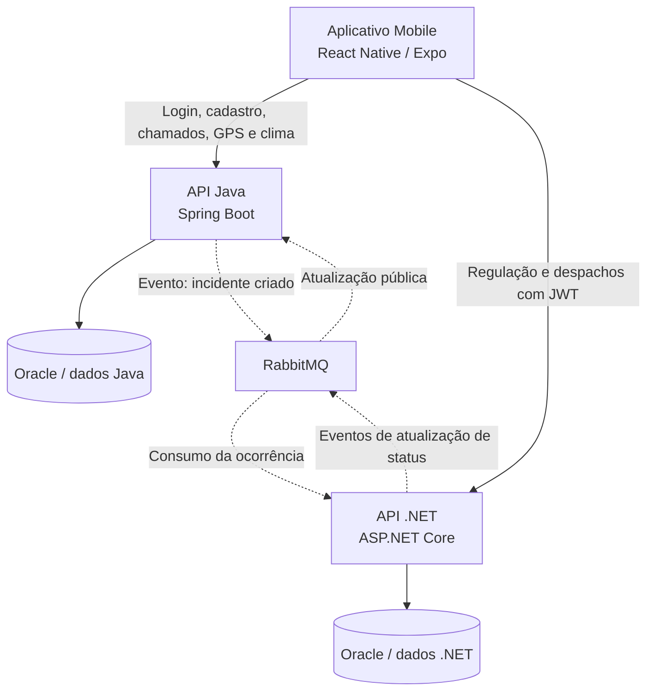

<p align="center">
  
</p>

<h1 align="center">🚨 Storm Aid - Aplicativo Mobile</h1>

<p align="center">
  Aplicativo desenvolvido em <strong>React Native, Expo e TypeScript</strong> para a <strong>Global Solution FIAP 2026/2 — CitizenTech</strong>.
</p>

O **Storm Aid** é uma plataforma de apoio à comunicação e à gestão de emergências. Seu objetivo é permitir que cidadãos em situações de risco solicitem ajuda, informem sua localização e acompanhem o andamento de seus chamados, enquanto profissionais autorizados realizam a regulação das ocorrências.

O aplicativo integra-se a duas APIs: **Java / Spring Boot**, responsável por autenticação, perfis, cadastro do cidadão e registro de chamados, e **ASP.NET Core / .NET**, responsável pela fila institucional, decisões de regulação, unidades de resgate e despachos. O projeto considera cenários como alagamentos, deslizamentos, incêndios, emergências médicas e outras situações que exigem apoio.

> **Projeto acadêmico:** o Storm Aid é um protótipo para demonstração. Não substitui os canais oficiais de emergência nem deve ser utilizado para pedir socorro real.

---

## 📑 Índice

- [👥 Integrantes do grupo](#-integrantes-do-grupo)
- [🎯 Problema e proposta](#-problema-e-proposta)
- [🏗️ Arquitetura e integrações](#️-arquitetura-e-integrações)
- [🔐 Perfis e permissões](#-perfis-e-permissões)
- [📱 Funcionalidades do aplicativo](#-funcionalidades-do-aplicativo)
- [🧩 Tecnologias utilizadas](#-tecnologias-utilizadas)
- [📁 Estrutura do projeto](#-estrutura-do-projeto)
- [⚙️ Configuração do ambiente](#️-configuração-do-ambiente)
- [▶️ Como executar](#️-como-executar)
- [📡 Endpoints consumidos](#-endpoints-consumidos)
- [🧪 Validação e testes](#-validação-e-testes)
- [🎥 Demonstração e protótipo](#-demonstração-e-protótipo)
- [⚠️ Limitações conhecidas](#️-limitações-conhecidas)
- [🔗 Repositórios e documentação](#-repositórios-e-documentação)
- [🤖 Uso de inteligência artificial](#-uso-de-inteligência-artificial)

---

## 👥 Integrantes do grupo

<table>
  <tr>
    <td width="115"></td>
    <td><strong>Moisés Barsoti Andrade de Oliveira</strong><br /><strong>RM:</strong> 565049 &nbsp;|&nbsp; <strong>Turma:</strong> 2TDSPO — FIAP</td>
  </tr>
  <tr>
    <td width="115"></td>
    <td><strong>Sofia Siqueira Fontes</strong><br /><strong>RM:</strong> 563829 &nbsp;|&nbsp; <strong>Turma:</strong> 2TDSPG — FIAP</td>
  </tr>
  <tr>
    <td width="115"></td>
    <td><strong>Manuela de Lacerda Soares</strong><br /><strong>RM:</strong> 564887 &nbsp;|&nbsp; <strong>Turma:</strong> 2TDSPG — FIAP</td>
  </tr>
</table>

---

## 🎯 Problema e proposta

Em situações de emergência, o cidadão pode ter dificuldades para descrever o ocorrido, compartilhar a localização ou saber se uma solicitação foi recebida. Essas dificuldades podem ser maiores em casos de eventos climáticos severos, mobilidade reduzida ou comunicação limitada.

O Storm Aid busca centralizar a solicitação e o acompanhamento de chamados em uma experiência mobile, com:

- **SOS silencioso**, que utiliza a localização do dispositivo;
- **Abertura de chamado por texto**, com seleção da categoria de emergência;
- **Acompanhamento dos status públicos** das solicitações;
- **Dados de acessibilidade** e contato de emergência no cadastro do cidadão;
- **Regulação institucional**, com registro de decisões e despachos no backend .NET.

A proposta se conecta especialmente aos **ODS 3 (Saúde e Bem-Estar), 10 (Redução das Desigualdades), 11 (Cidades e Comunidades Sustentáveis) e 13 (Ação Contra a Mudança Global do Clima)**.

---

## 🏗️ Arquitetura e integrações



**Responsabilidades dos módulos:**

| Módulo | Responsabilidade |
| --- | --- |
| **Mobile** | Experiência do cidadão e interface de regulação, formulários, GPS, autenticação e consumo HTTP |
| **API Java** | Cadastro e autenticação, emissão de JWT, usuários, perfil do cidadão, ocorrências e informações meteorológicas |
| **API .NET** | Listagem institucional, análise, decisões, unidades de resgate e despachos |
| **Oracle Database** | Persistência dos domínios administrados pelos backends |
| **RabbitMQ** | Troca assíncrona de eventos entre Java e .NET na arquitetura integrada |
| **Cloudinary** | Upload de imagem de perfil, mediante configuração do ambiente |

> **Estado da mensageria:** a documentação do .NET registra RabbitMQ e Outbox validados em laboratório, mas desabilitados no ambiente HTTP do Render. Portanto, o fluxo completo de sincronização Java → .NET → Java **não deve ser considerado validado em produção** apenas porque as duas APIs estão online.

---

## 🔐 Perfis e permissões

O login é realizado na **API Java**, que emite o JWT. O `AuthContext` consulta a identidade autenticada, verifica o status da conta e direciona a navegação conforme a role retornada.

| Perfil | Acesso no Mobile | Estado no código analisado |
| --- | --- | --- |
| `CITIZEN` | Início, Contatos e Conta | Telas e integrações implementadas |
| `REGULATOR` | Fila de ocorrências, detalhes, análise, decisões e despacho | Tela implementada com consumo da API .NET; depende dos dados e permissões do backend |
| `RESPONDER` | Entrada específica para socorristas | Tela `HomeResponderScreen` ainda provisória |

A API .NET **não possui login próprio**: as chamadas institucionais reutilizam o JWT emitido pelo Java, com autorização por perfil.

### Autenticação biométrica

O aplicativo permite habilitar autenticação biométrica no dispositivo por meio do `expo-local-authentication` e protege o token no `expo-secure-store`. O recurso exige sensor biométrico e biometria cadastrada no aparelho.

**Limitação:** a biometria reutiliza um JWT válido. Quando o token expira, é necessário entrar novamente com e-mail e senha e reativar a biometria; não existe fluxo de refresh token prolongado implementado neste Mobile.

---

## 📱 Funcionalidades do aplicativo

### 1. Acesso e cadastro

- Login por e-mail e senha integrado à API Java;
- Validação de campos e mensagens de erro;
- Autorização e navegação de acordo com `CITIZEN`, `REGULATOR` e `RESPONDER`;
- Cadastro completo do cidadão em **quatro etapas**:
  1. **Dados pessoais:** nome, e-mail, telefone, CPF, nascimento e senha;
  2. **Endereço:** CEP, logradouro, número, complemento, bairro, cidade e UF;
  3. **Acessibilidade:** informações de mobilidade, limitações e equipamentos essenciais;
  4. **Contato de emergência:** nome, telefone e parentesco, com opção de não informar contato.

Os dados são mantidos temporariamente em um rascunho local protegido pelo SecureStore. **A solicitação de cadastro completo é enviada à API somente na confirmação da última etapa.**

### 2. Área do cidadão — Início

- Cabeçalho com identificação do usuário e foto de perfil;
- Consulta de condições meteorológicas baseada na localização atual;
- Botão **SOS**, com confirmação antes do envio;
- Solicitação de ajuda por texto nas categorias: risco policial, emergência médica, incêndio/resgate, desastre climático e outra emergência;
- Captura de localização por GPS após permissão do usuário;
- Envio de ocorrências para a API Java com **chave de idempotência**;
- Listagem de chamados do próprio cidadão e visualização de status;
- Atualização da lista após a criação de um chamado.

Os contratos contemplam os canais `TEXT_INPUT` e `SOS_SILENT`. A presença de `VOICE_AUDIO` nos tipos de integração **não equivale à implementação de gravação e envio por voz no Mobile**.

### 3. Área do cidadão — Contatos

- Consulta do contato de emergência registrado no perfil do cidadão;
- Exibição de nome, parentesco e telefone;
- Cadastro de contato quando ainda não existe um registro;
- Edição dos dados do contato existente;
- Atalho para ligação telefônica.

**Importante:** o contrato Java utilizado neste projeto permite **um contato de emergência por cidadão**. O botão de cadastro não cria uma lista de contatos adicionais.

### 4. Área do cidadão — Minha conta

- Foto de perfil com seleção de imagem e integração opcional com Cloudinary;
- Exibição dos dados básicos do usuário;
- Edição de nome e telefone;
- Ativação e desativação da biometria;
- Preferência de aparência: **Claro, Escuro ou Automático**;
- Informações da versão do aplicativo;
- Saída da conta;
- Solicitação de desativação da conta com confirmação.

A ação identificada na interface como **“Excluir conta”** utiliza a operação de **desativação** do backend; não representa exclusão física garantida dos registros no Oracle.

### 5. Área do regulador

A `HomeRegulatorScreen` utiliza diretamente a API .NET para:

- Listar ocorrências com filtros por status e paginação;
- Abrir detalhes de um chamado e conferir categoria, localização e situação;
- Iniciar a análise institucional (`PENDING_REVIEW` → `UNDER_REVIEW`);
- Registrar decisões com justificativa:
  - `DISPATCH_APPROVED` — aprovar envio de equipe;
  - `MORE_INFORMATION_REQUIRED` — solicitar informações adicionais;
  - `NO_DISPATCH_REQUIRED` — encerrar sem despacho;
- Selecionar a instituição responsável quando houver aprovação;
- Consultar unidades de resgate;
- Criar despacho após aprovação;
- Atualizar a fila, tratar erros e encerrar sessão.

As regras finais de estado, permissão e disponibilidade de unidades são validadas pelo backend .NET.

---

## 🧩 Tecnologias utilizadas

| Tecnologia / biblioteca | Uso |
| --- | --- |
| **React Native 0.88 / React 19** | Construção da interface mobile |
| **Expo SDK 58** | Ambiente e módulos nativos |
| **TypeScript** | Tipagem dos contratos, screens e componentes |
| **React Navigation 7** | Stack Navigator e Bottom Tabs |
| **TanStack React Query** | Infraestrutura de cliente de consultas |
| **Expo Secure Store** | Rascunho do cadastro e informações locais protegidas |
| **Expo Local Authentication** | Biometria do dispositivo |
| **Expo Location** | Permissão e leitura de localização GPS |
| **Expo Crypto** | Suporte à geração de identificadores para solicitações |
| **Expo Image Picker / File System** | Seleção e manipulação de imagens |
| **Expo Google Fonts** | Tipografias Inter e Sora |
| **Expo Vector Icons** | Ícones de navegação e interface |
| **Fetch API** | Comunicação HTTP com Java, .NET e serviços externos |
| **Cloudinary** | Armazenamento de fotos de perfil, quando configurado |

As versões detalhadas das dependências estão no `package.json` e no `package-lock.json`.

---

## 📁 Estrutura do projeto

```text
stormaid/
├── App.tsx                     # Providers e navegação principal
├── app.json                    # Configuração Expo
├── package.json                # Dependências e scripts
├── android/                    # Projeto nativo Android
├── ios/                        # Projeto nativo iOS
└── src/
    ├── api/                    # QueryClient
    ├── assets/                 # Logo e imagens
    ├── components/             # Formulários, cards, seções e modais
    ├── context/                # AuthContext, ThemeContext e foto de perfil
    ├── data/                   # Opções estáticas dos formulários
    ├── hooks/                  # Estado e operações de telas específicas
    ├── navigation/             # AppNavigator e TabNavigator
    ├── screens/
    │   ├── LoginScreen/
    │   ├── CreateAccountScreen/
    │   ├── SendCodeToEmailScreen/
    │   ├── HomeCitizenScreen/
    │   ├── ContactsCitizenScreen/
    │   ├── AccountCitizenScreen/
    │   ├── HomeRegulatorScreen/
    │   └── HomeResponderScreen/
    ├── services/               # Clientes HTTP e integrações
    ├── styles/                 # Paleta de cores e fontes
    ├── types/                  # Contratos TypeScript
    └── utils/                  # Validações auxiliares
```

A interface utiliza **estilos inline nos componentes**, com as cores centralizadas em `src/styles/style.ts` e distribuídas pelo `ThemeContext`. As telas do cidadão, exceto a Home, utilizam o cabeçalho azul reutilizável `PageHeader`.

---

## ⚙️ Configuração do ambiente

Crie um arquivo `.env` na **raiz do projeto**, ao lado de `package.json`:

```dotenv
# Endpoints dos backends
EXPO_PUBLIC_API_URL=https://stormaid-java-gs.onrender.com
EXPO_PUBLIC_DOTNET_API_URL=https://stormaid-dotnet-gs.onrender.com

# Habilitação dos envios no ambiente acadêmico de desenvolvimento
EXPO_PUBLIC_API_ENVIRONMENT=demo
EXPO_PUBLIC_ENABLE_INCIDENT_SUBMISSION=true
EXPO_PUBLIC_ENABLE_SOS_SUBMISSION=true

# Upload de fotos — preencher somente se usar Cloudinary
EXPO_PUBLIC_CLOUDINARY_CLOUD_NAME=SEU_CLOUD_NAME
EXPO_PUBLIC_CLOUDINARY_UPLOAD_PRESET=SEU_UPLOAD_PRESET

# Metadados opcionais mostrados em "Sobre o aplicativo"
EXPO_PUBLIC_APP_VERSION=1.0.0
# EXPO_PUBLIC_GIT_COMMIT=HASH_REAL_DA_RELEASE
# EXPO_PUBLIC_GIT_BRANCH=main
# EXPO_PUBLIC_RELEASE_DATE=DATA_REAL_DA_PUBLICACAO
```

**Regras de habilitação dos chamados:**

- `test`: permite envio em desenvolvimento **somente para uma URL diferente da API Java de produção**;
- `demo`: permite envio em desenvolvimento para a URL acadêmica publicada do Java;
- `production`: permite envio em build não-dev usando a URL publicada;
- As flags `EXPO_PUBLIC_ENABLE_INCIDENT_SUBMISSION` e `EXPO_PUBLIC_ENABLE_SOS_SUBMISSION` precisam estar como `true` para habilitar os respectivos botões.

> **Segurança:** variáveis `EXPO_PUBLIC_` ficam disponíveis no bundle do aplicativo. **Nunca coloque chaves privadas, senhas, segredos JWT ou credenciais SMTP nelas.** O `.env` está ignorado pelo `.gitignore`. O ambiente `demo` deve ser usado somente com dados fictícios e serviços acadêmicos isolados de centrais reais.

---

## ▶️ Como executar

### Pré-requisitos

- Node.js e npm compatíveis com as dependências do `package.json`;
- Android Studio e um emulador Android, ou um dispositivo compatível;
- Para desenvolvimento iOS, macOS com Xcode e simulador iOS;
- Conectividade com as APIs Java e .NET e credenciais **de teste** compatíveis com o perfil que será demonstrado.

### 1. Clonar o repositório

```bash
git clone https://github.com/2026-2Semestre-Stormaid-Global-Solution/stormaid-mobile-gs.git
cd stormaid-mobile-gs
```

### 2. Instalar as dependências

```bash
npm ci
```

### 3. Configurar o ambiente

Crie o `.env` conforme a seção anterior. Não publique credenciais de acesso no repositório.

### 4. Executar no Android

```bash
npm run android
```

O script usa `expo run:android` e prepara/abre uma build de desenvolvimento. Depois da instalação, para iniciar o Metro com cache limpo:

```bash
npx expo start --clear
```

Para executar no simulador iOS, em um Mac configurado:

```bash
npm run ios
```

> O comando `npm start` do projeto utiliza `expo start --dev-client`, exigindo uma build de desenvolvimento compatível. O repositório contém as pastas nativas `android/` e `ios/`.

---

## 📡 Endpoints consumidos

### API Java — `https://stormaid-java-gs.onrender.com`

| Método | Endpoint | Uso no Mobile |
| --- | --- | --- |
| `POST` | `/api/v1/auth/login` | Login |
| `GET` | `/api/v1/auth/me` | Consulta da sessão e perfil |
| `POST` | `/api/v1/auth/register-complete` | Cadastro completo do cidadão |
| `GET` | `/api/v1/addresses/cep/{cep}` | Consulta de endereço por CEP |
| `GET` | `/api/v1/weather/summary` | Clima pelas coordenadas do usuário |
| `GET` | `/api/v1/incidents` | Chamados do cidadão |
| `POST` | `/api/v1/incidents` | Novo chamado e SOS silencioso |
| `GET` | `/api/v1/citizens/me/profile` | Consulta do contato de emergência |
| `PUT` | `/api/v1/citizens/me/profile` | Cadastro/edição do contato existente |
| `PUT` | `/api/v1/users/me` | Edição dos dados da conta |
| `DELETE` | `/api/v1/users/me` | Desativação da conta |
| `GET` | `/api/v1/responders/me/profile` | Consulta de perfil institucional |

O código também contém chamadas de recuperação de senha (`/api/v1/password-recovery/request`, `/verify` e `/reset`), mas o acesso a esse fluxo foi removido do formulário de login na versão analisada.

### API .NET — `https://stormaid-dotnet-gs.onrender.com`

| Método | Endpoint | Uso no Mobile |
| --- | --- | --- |
| `GET` | `/api/v1/regulation/incidents` | Listar chamados da regulação |
| `GET` | `/api/v1/regulation/incidents/{id}` | Detalhes institucionais |
| `POST` | `/api/v1/regulation/incidents/{id}/review` | Iniciar análise |
| `POST` | `/api/v1/regulation/incidents/{id}/decisions` | Registrar decisão |
| `GET` | `/api/v1/rescue-units` | Consultar unidades disponíveis |
| `POST` | `/api/v1/dispatches` | Criar despacho operacional |

**Autorização:** as operações protegidas enviam `Authorization: Bearer <JWT>`. A criação de chamados também utiliza o cabeçalho `Idempotency-Key` para evitar registros duplicados decorrentes de repetição da solicitação.

### Exemplo: abertura de ocorrência

```http
POST /api/v1/incidents HTTP/1.1
Authorization: Bearer <JWT_DO_CIDADAO>
Idempotency-Key: <UUID_DA_SOLICITACAO>
Content-Type: application/json
```

O payload enviado pelo aplicativo contém categoria, canal (`TEXT_INPUT` ou `SOS_SILENT`), destinatário, descrição quando aplicável e coordenadas obtidas mediante autorização do usuário.

---

## 🧪 Validação e testes

### Verificação estática

```bash
npx tsc --noEmit
git diff --check
```

O `package.json` analisado **não define um comando próprio de testes automatizados**. Os comandos acima verificam tipos e problemas de formatação do diff; **não substituem testes funcionais no emulador**.

### Roteiro de validação manual

| Cenário | Resultado esperado |
| --- | --- |
| Login com credenciais válidas | Acesso ao fluxo correspondente à role |
| Login inválido | Feedback de erro, sem autenticar |
| Cadastro em quatro etapas | Um único envio ao Java na confirmação final |
| GPS negado | Mensagem de erro e nenhuma solicitação enviada |
| Novo chamado | Resposta de criação e atualização da listagem |
| SOS silencioso | Confirmação explícita, localização e criação do chamado |
| Contato de emergência | Consulta e edição de um contato no perfil |
| Edição da conta | Atualização de nome/telefone via Java |
| Biometria | Autenticação com token ainda válido; tratamento de expiração |
| Regulador sem JWT adequado | Acesso negado pelo backend |
| Regulador com ocorrência disponível | Visualização, análise e registro de decisão conforme as regras do .NET |
| API indisponível ou HTTP 429 | Feedback adequado ao usuário |

**Persistência:** a existência de cards ou uma resposta visual não substitui a confirmação dos dados nos respectivos backends e no Oracle. Para a demonstração ponta a ponta, é necessário que a mensageria entre Java e .NET esteja operacional ou que existam registros institucionais de teste válidos no .NET.

---

## 🎥 Demonstração e protótipo

- **Vídeo de demonstração do Mobile:** https://www.youtube.com/watch?v=n-koasbRXlU

---

## ⚠️ Limitações conhecidas

1. **Socorrista:** `HomeResponderScreen` ainda exibe conteúdo provisório; não há fluxo operacional de despacho implementado nessa tela.
2. **Recuperação de senha:** componentes e service existem, mas o acesso foi retirado do login e o envio de e-mail não foi validado no ambiente publicado.
3. **Contatos de emergência:** apenas **um** contato por cidadão na integração Java atual; cadastro de múltiplos contatos não está implementado.
4. **RabbitMQ no Render:** o fluxo institucional assíncrono contínuo não foi demonstrado como habilitado. Um chamado criado no Java pode não aparecer na fila do .NET sem a integração ativa.
5. **CRUD Mobile:** existem operações de consulta e criação de chamados, edição de perfil e desativação de conta, mas **não há CRUD completo de um mesmo recurso** implementado na interface analisada.
6. **Biometria:** depende de JWT ainda válido; sem refresh token prolongado.
7. **Publicação em lojas:** a presença dos projetos nativos Android/iOS e da versão `1.0.0` não comprova distribuição pela Google Play ou App Store. É necessário acrescentar a evidência caso a publicação seja realizada.
8. **Metadados do app:** o modal “Sobre o app” usa variáveis de build (`EXPO_PUBLIC_*`) e **não consulta dinamicamente** `/api/v1/app/info` na versão do ZIP analisado.

---

## 🔗 Repositórios e documentação

| Recurso | Link |
| --- | --- |
| **Mobile (GitHub)** | https://github.com/2026-2Semestre-Stormaid-Global-Solution/stormaid-mobile-gs |
| **API .NET (GitHub)** | https://github.com/2026-2Semestre-Stormaid-Global-Solution/stormaid-dotnet-gs |
| **API Java (Render)** | https://stormaid-java-gs.onrender.com |
| **Swagger Java** | https://stormaid-java-gs.onrender.com/swagger-ui/index.html |
| **API .NET (Render)** | https://stormaid-dotnet-gs.onrender.com |
| **Swagger .NET** | https://stormaid-dotnet-gs.onrender.com/swagger/index.html |

---

## 🤖 Uso de inteligência artificial

Ferramentas de IA generativa foram utilizadas como **apoio ao desenvolvimento**, diagnóstico de erros e documentação.

---
